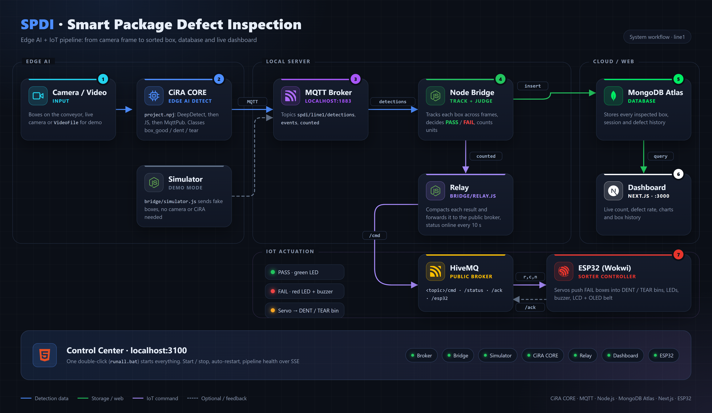
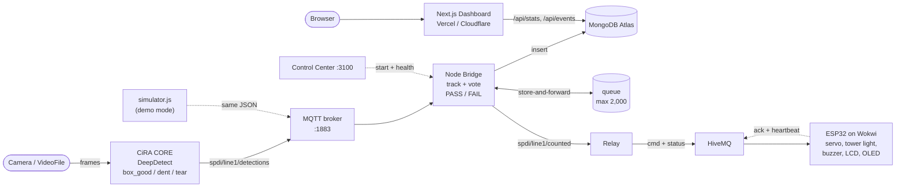
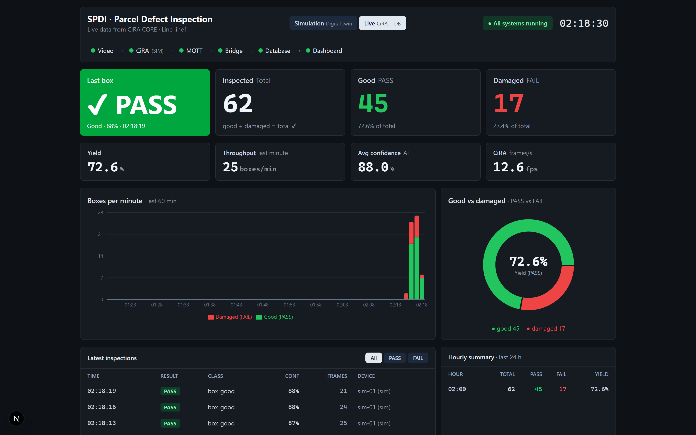
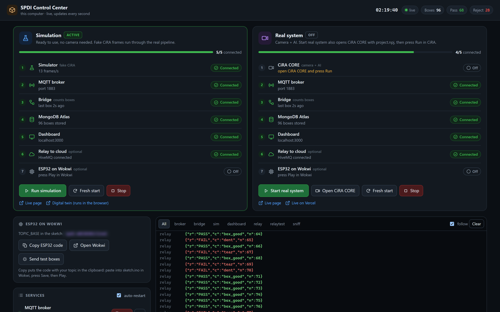
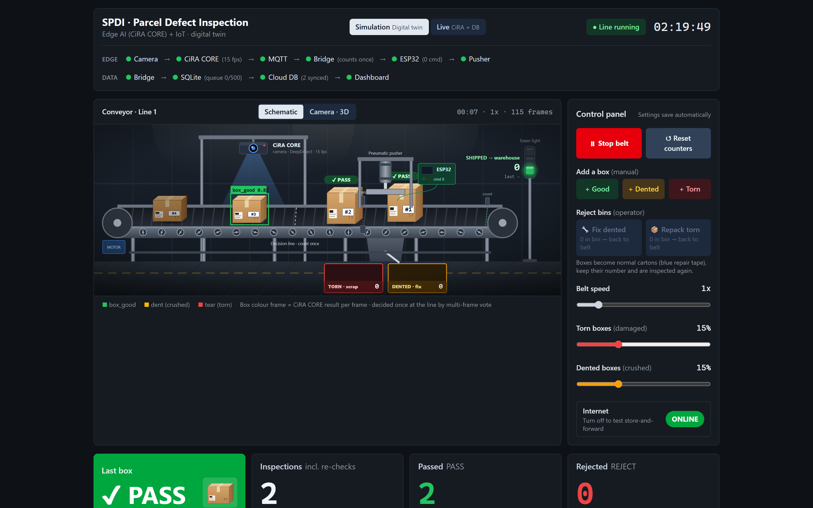
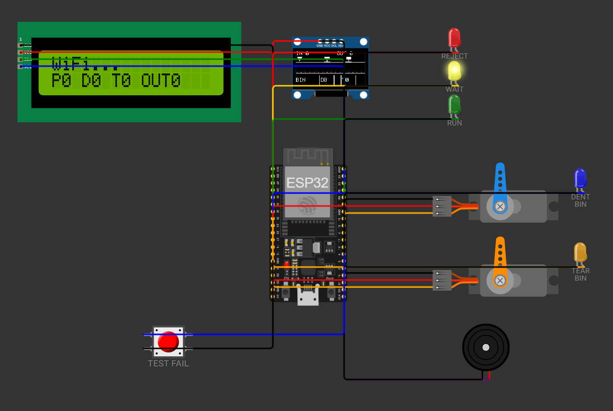

# SPDI: AI Parcel Box Damage Detection System

ระบบตรวจจับและคัดแยกพัสดุชำรุดก่อนเข้าสู่ระบบขนส่ง ด้วย Edge AI และ IoT
*Smart Parcel Damage Inspector & Integrity Sorter using Edge AI and IoT*

CiRA CORE ตรวจกล่องพัสดุบนสายพาน แยก **กล่องดี (`box_good`)**, **บุบ (`dent`)** และ **ฉีกขาด (`tear`)** จากนั้น Bridge ตัดสิน PASS / FAIL ครั้งเดียวต่อกล่อง บันทึกลง MongoDB Atlas แสดงบน Dashboard แบบ real-time และสั่ง ESP32 ดันกล่องเสียลงถังแยก

- Dashboard ออนไลน์: https://boxdetections.vercel.app
- สไลด์นำเสนอ: [docs/slides](docs/slides/)

## System Architecture

แผนภาพละเอียด (2 แผนภาพ + ตารางส่วนประกอบ): [docs/system-architecture.md](docs/system-architecture.md)

## ระบบทำงานอย่างไร

| ขั้น | ส่วน | ทำอะไร |
|---|---|---|
| 1 | กล้อง / ไฟล์วิดีโอ | ภาพกล่องบนสายพาน |
| 2 | **CiRA CORE** (Edge AI) | `project.npj`: VideoFile → DeepDetect → JavaScript → MqttPub ตรวจจับทุกเฟรม |
| 3 | **MQTT broker** (localhost:1883) | รับส่งข้อมูลในเครื่อง ไม่ต้องใช้อินเทอร์เน็ต |
| 4 | **Node Bridge** | ติดตามกล่องข้ามเฟรม นับเมื่อข้ามเส้นเสมือน (เห็นอย่างน้อย 5 เฟรม, ตัดผลความมั่นใจต่ำกว่า 50%) โหวตชำรุด ≥ 30% → FAIL |
| 5 | **MongoDB Atlas** | เก็บผลทุกกล่อง ถ้าฐานข้อมูลหรือเน็ตหลุด Bridge เก็บไว้ในคิว (สูงสุด 2,000) แล้วส่งให้เองเมื่อกลับมา |
| 6 | **Next.js Dashboard** | KPI, Yield, Throughput, กราฟรายนาที, สัดส่วนดี/เสีย, สรุปรายชั่วโมง |
| 7 | **Relay → HiveMQ → ESP32** | ESP32 (Wokwi) ไฟ 3 สี, Buzzer, Servo ดันกล่องลงถัง DENT / TEAR, จอ LCD + OLED |

ควบคุมทั้งหมดผ่าน **Control Center** (http://localhost:3100)

| Dashboard (Live) | Control Center |
|---|---|
|  |  |

| Digital Twin บนเว็บ | ESP32 บน Wokwi |
|---|---|
|  |  |

## เริ่มใช้งาน (Windows)

**ต้องมีก่อน:** Node.js 20+ ([nodejs.org](https://nodejs.org)) และบัญชี MongoDB Atlas ฟรี (connection string 1 บรรทัด)

| ไฟล์ / ปุ่ม | ทำเมื่อไร | ทำอะไร |
|---|---|---|
| `1-SETUP.bat` | ครั้งแรกครั้งเดียว | ติดตั้งทุกอย่าง และถามให้วาง connection string |
| **`runall.bat`** หรือไอคอน **SPDI** บน Desktop | ทุกครั้ง | เปิด Control Center และรันทุกส่วน (broker, bridge, simulator, dashboard, relay) · กด **C** = ใช้ CiRA จริง, **W** = เปิดเว็บอย่างเดียว |
| ปุ่ม **Start real system** ใน Control Center | ใช้กล้องจริง | เปิด CiRA CORE พร้อม `project.npj` ให้เอง แล้วกด Run ใน CiRA |

ใน Control Center มี 2 แผงแยกกัน **Simulation** (รันได้ทันที ไม่ต้องมีกล้อง) กับ **Real system** (CiRA CORE) แต่ละแผงแสดงสถานะ 7 ขั้นแบบ real-time และมีปุ่ม Fresh start, Auto-restart, Copy ESP32 code

## ESP32 (Wokwi)

วงจรและวิธีใช้: [esp32/README.md](esp32/README.md)

- **บนเว็บ:** Control Center → **Copy ESP32 code** → วางใน `sketch.ino` บน wokwi.com → Save → Play
- **ใน VS Code (เร็วกว่า):** `npm run esp32:setup` ครั้งแรก, `npm run esp32:build`, แล้วเปิด `esp32/wokwi/diagram.json` → `F1` → **Wokwi: Start Simulator**

## คำสั่งที่ใช้บ่อย

| คำสั่ง | ทำอะไร |
|---|---|
| `npm run setup` | ติดตั้ง dependencies ของ root, bridge และ dashboard |
| `npm run control` | เปิด Control Center |
| `npm run all` | broker + bridge + simulator + dashboard + relay (ที่ `runall.bat` ใช้) |
| `npm run all:cira` | เหมือนข้างบน แต่ใช้ CiRA จริงแทน simulator |
| `npm run sim` | ส่งเฟรมจำลองแบบเดียวกับ CiRA |
| `npm run sniff` | ดูทุกข้อความ MQTT ใน `spdi/#` |
| `npm run relay` / `relay:test` | ส่งผลไป ESP32 / ส่ง PASS-FAIL ทดสอบทุก 3 วินาที |
| `npm run reset` | ลบข้อมูลการตรวจทั้งหมด (ถามยืนยันก่อน) |
| `npm run esp32:build` | คอมไพล์ firmware ESP32 สำหรับ Wokwi ใน VS Code |
| `npm test` | unit tests ของ tracker |

## MQTT topics

| Topic | จาก → ถึง | ข้อมูล |
|---|---|---|
| `spdi/line1/detections` | CiRA / simulator → Bridge | ผลทุกเฟรม `{objects:[{name,conf,x,y,w,h}]}` |
| `spdi/line1/counted` | Bridge → Relay | กล่องที่นับแล้ว PASS / FAIL |
| `<RELAY_TOPIC>/cmd` | Relay → ESP32 | `{"r":"FAIL","c":"tear","n":51}` |
| `<RELAY_TOPIC>/status` | Relay → ESP32 | `online` / `offline` (retained, ส่งซ้ำทุก 10 วินาที) |
| `<RELAY_TOPIC>/ack`, `/esp32` | ESP32 → Relay | ยืนยันการทำงาน + heartbeat |

`RELAY_TOPIC` สุ่มสร้างครั้งแรกและเก็บใน `bridge/.env` (ไม่ขึ้น git)

## Deploy Dashboard

Broker, Bridge และ CiRA รันบนเครื่องหน้างาน ส่วนที่ขึ้นเว็บคือ `dashboard/` เท่านั้น

**Vercel** (ใช้อยู่: boxdetections.vercel.app)
- Framework = Next.js, Root Directory = `dashboard`
- Environment Variables: `MONGODB_URI`, `DB_NAME` (ห้ามใช้ `NEXT_PUBLIC_`)

**Cloudflare Workers** (ผ่าน [OpenNext](https://opennext.js.org/cloudflare), config อยู่ใน `dashboard/wrangler.jsonc`)
1. Cloudflare Dashboard → Workers & Pages → Create → Import a repository → เลือก repo นี้
2. Root directory = `dashboard`, Build command = `npx opennextjs-cloudflare build`, Deploy command = `npx opennextjs-cloudflare deploy`
3. Settings → Variables and Secrets: เพิ่ม `MONGODB_URI` (Secret) และ `ADMIN_TOKEN` ถ้าต้องการ
4. หรือ deploy จากเครื่อง Linux / macOS / WSL: `cd dashboard` แล้ว `npx wrangler login` และ `npm run cf:deploy`

> บน Windows การ build ของ OpenNext ต้องเปิด Developer Mode (ใช้ symlink) จึงแนะนำให้ Cloudflare build ให้จาก GitHub

ทั้งสองแบบ: MongoDB Atlas → Network Access ต้องอนุญาตให้เซิร์ฟเวอร์ cloud เข้าได้ (`0.0.0.0/0` ระหว่าง demo แล้วลบออกหลังใช้งาน)

## โครงสร้างโปรเจกต์

| โฟลเดอร์ | คืออะไร |
|---|---|
| `bridge/` | Node.js: รับ MQTT → ติดตาม/นับ → MongoDB, simulator, relay, dev broker |
| `dashboard/` | Next.js Dashboard + Digital Twin (deploy ได้ทั้ง Vercel และ Cloudflare) |
| `esp32/` | Firmware ESP32 + วงจร Wokwi |
| `cira/` + `project.npj` | ไฟล์งาน CiRA CORE และโค้ดสำหรับ JavaScript node |
| `tools/` | Control Center, build ESP32, auto-label, ทำวิดีโอ |
| `docs/` | Workflow diagram, ภาพหน้าจอ, สไลด์, สถาปัตยกรรม, troubleshooting |

รายละเอียดเพิ่มเติม: [docs/ARCHITECTURE.md](docs/ARCHITECTURE.md) · [docs/DEMO_SCRIPT.md](docs/DEMO_SCRIPT.md) · [docs/TROUBLESHOOTING.md](docs/TROUBLESHOOTING.md) · [cira/README_CIRA.md](cira/README_CIRA.md)

## ความปลอดภัย

- ห้าม commit `.env`, `.env.local`, `.dev.vars` (อยู่ใน `.gitignore` แล้ว) ถ้าเผลอ push รหัส Atlas ให้เปลี่ยนรหัสทันที
- Broker ในเครื่องเป็นแบบไม่มีรหัส ใช้เฉพาะ demo ใน LAN ที่ไว้ใจได้
- ส่งไป HiveMQ เฉพาะผล PASS/FAIL แบบย่อ ไม่มีภาพหรือข้อมูลฐานข้อมูล และ topic มีส่วนสุ่ม
- `/api/reset` ปิดอยู่จนกว่าจะตั้ง `ADMIN_TOKEN`

## ทีมผู้จัดทำ

| รหัส | ชื่อ | หน้าที่ | งานที่รับผิดชอบ |
|---|---|---|---|
| 66013507 | วชิระ เฟื้อแก้ว | AI & Computer Vision | CiRA CORE, เทรนโมเดล box_good / dent / tear, จูน Confidence |
| 66088911 | เศรษฐพงศ์ สงวนสุข | Dashboard & UI | Next.js Dashboard, MongoDB Atlas, API, Deploy เว็บ, Control Center |
| 66039252 | นนทพัทธ์ จีนเกิด | Embedded & Control | ESP32 บน Wokwi, Servo คัดแยก, Tower light, Buzzer, LCD / OLED |
| 66027138 | ณัฐวัฒน์ ปราณวรกิจ | Backend & Data Pipeline | MQTT, Node Bridge, คิวเก็บและส่งต่อข้อมูล, Relay ไป ESP32 |
