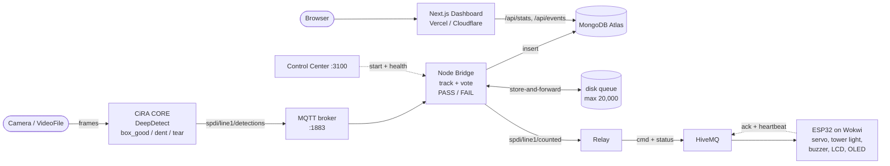

# SPDI: AI Parcel Box Damage Detection System

ระบบตรวจจับและคัดแยกพัสดุชำรุดก่อนเข้าสู่ระบบขนส่ง ด้วย Edge AI และ IoT
*Smart Parcel Damage Inspector & Integrity Sorter using Edge AI and IoT*

CiRA CORE ตรวจกล่องพัสดุบนสายพาน แยก **กล่องดี (`box_good`)**, **บุบ (`dent`)** และ **ฉีกขาด (`tear`)** จากนั้น Bridge ตัดสิน PASS / FAIL ครั้งเดียวต่อกล่อง บันทึกลง MongoDB Atlas แสดงบน Dashboard แบบ real-time และสั่ง ESP32 ดันกล่องเสียลงถังแยก

- Dashboard ออนไลน์: https://boxdetections.vercel.app
- สไลด์นำเสนอ: [docs/slides](docs/slides/)

## System Architecture

แผนภาพละเอียด (2 แผนภาพ + ตารางส่วนประกอบ): [docs/system-architecture.md](docs/system-architecture.md)

## ระบบทำงานอย่างไร

| ขั้น | ส่วน | ทำอะไร |
|---|---|---|
| 1 | กล้อง / ไฟล์วิดีโอ | ภาพกล่องบนสายพาน |
| 2 | **CiRA CORE** (Edge AI) | `project.npj`: VideoFile → DeepDetect → JavaScript → MqttPub ตรวจจับทุกเฟรม |
| 3 | **MQTT broker** (localhost:1883) | รับส่งข้อมูลในเครื่อง ไม่ต้องใช้อินเทอร์เน็ต |
| 4 | **Node Bridge** | ติดตามกล่องข้ามเฟรม นับเมื่อข้ามเส้นเสมือน (เห็นอย่างน้อย 5 เฟรม, ตัดผลความมั่นใจต่ำกว่า 50%) โหวตชำรุด ≥ 30% → FAIL |
| 5 | **MongoDB Atlas** | เก็บผลทุกกล่อง ถ้าฐานข้อมูลหรือเน็ตหลุด Bridge เก็บไว้ในคิว (สูงสุด 2,000) แล้วส่งให้เองเมื่อกลับมา |
| 6 | **Next.js Dashboard** | KPI, Yield, Throughput, กราฟรายนาที, สัดส่วนดี/เสีย, สรุปรายชั่วโมง |
| 7 | **Relay → HiveMQ → ESP32** | ESP32 (Wokwi) ไฟ 3 สี, Buzzer, Servo ดันกล่องลงถัง DENT / TEAR, จอ LCD + OLED |

ควบคุมทั้งหมดผ่าน **Control Center** (http://localhost:3100)

| Dashboard (Live) | Control Center |
|---|---|
|  |  |

| ESP32 บน Wokwi |
|---|
|  |

## เริ่มใช้งาน (Windows)

**ต้องมีก่อน:** Node.js 20+ ([nodejs.org](https://nodejs.org)) และบัญชี MongoDB Atlas ฟรี (connection string 1 บรรทัด)

| ไฟล์ / ปุ่ม | ทำเมื่อไร | ทำอะไร |
|---|---|---|
| `1-SETUP.bat` | ครั้งแรกครั้งเดียว | ติดตั้งทุกอย่าง และถามให้วาง connection string |
| **`runall.bat`** หรือไอคอน **SPDI** บน Desktop | ทุกครั้ง | เปิด Control Center และรันระบบจริง (broker, bridge, dashboard, relay) แล้วกด Run ใน CiRA CORE · กด **W** = เปิดเว็บอย่างเดียว |
| ปุ่ม **Start real system** ใน Control Center | ใช้กล้องจริง | เปิด CiRA CORE พร้อม `project.npj` ให้เอง แล้วกด Run ใน CiRA |

**CiRA input (ในแผง Real system):** เลือกได้ 2 แบบ
- **Video:** VideoFile / กล้อง นับเมื่อกล่องวิ่งข้ามเส้นเสมือน (ค่าเริ่มต้น)
- **Still:** กล่องวางนิ่งหน้ากล้อง นับเมื่อเห็นนิ่งครบ MIN_FRAMES เฟรม ไม่ต้องข้ามเส้น
- **Images:** Image Slide **ภาพ 1 ใบ = กล่อง 1 กล่อง** ภาพเดิมที่ส่งซ้ำนับครั้งเดียว ถ้ามีคลาสชำรุดในภาพ → FAIL
- กดสลับแล้ว Bridge รีสตาร์ทให้เอง (ตั้งค่าเริ่มต้นได้ที่ `INPUT_MODE` ใน `bridge/.env`)

**Dashboard** (`/`, ลิงก์เก่า `/live` ยังใช้ได้) แสดงเฉพาะข้อมูลจริงจาก MongoDB
- **Live conveyor แบบ 3D** (สลับเป็น 2D ได้, ลากเมาส์เพื่อหมุน, เลื่อนลูกกลิ้งเพื่อซูม, ดับเบิลคลิกเพื่อกลับมุมเดิม): ทุกกล่องที่ CiRA ตรวจจับและ Bridge นับแล้ว จะออกมาที่หัวสายพานหลังจากนั้น 2–5 วินาที ด้วย**ขนาดตามที่ CiRA ตรวจจับได้** แล้ววิ่งไปตามผลจริง (PASS ออกปลายสาย, FAIL ถูกดันลงถัง BAD)
- ตาราง Latest inspections และไฟล์ CSV มีขนาดกล่องของแต่ละกล่อง

**ขนาดกล่อง (กว้าง × ยาว × สูง)** มาจากกรอบที่ CiRA ตรวจจับ เฉลี่ยจากทุกเฟรมที่เห็นกล่องนั้น
- กล้องตัวเดียวเห็นได้ 2 ด้าน: `CAMERA_VIEW=top` (มองลงมา) ได้ **ยาว × กว้าง**, `CAMERA_VIEW=side` (มองด้านข้าง) ได้ **ยาว × สูง**
- ด้านที่ 3 ใส่เป็นค่าคงที่ได้ที่ `BOX_FIXED_DIM_CM` (เว้นไว้ = แสดง `?`) ถ้าต้องวัดครบ 3 ด้านจริง ต้องเพิ่มกล้องตัวที่ 2 หรือเซนเซอร์วัดระยะ
- ให้เป็นหน่วย **cm**: วัดด้วยไม้บรรทัดว่ากล้องเห็นสายพานกว้างและยาวกี่ cm แล้วใส่ `FRAME_WIDTH_CM` และ `FRAME_HEIGHT_CM` ใน Control Center → Bridge settings (ไม่ใส่ = แสดงเป็น % ของภาพ)
- ไม่ต้องแก้อะไรใน CiRA CORE รายละเอียดและวิธีวัดครบ 3 ด้าน: [cira/BOX_SIZE.md](cira/BOX_SIZE.md)

Control Center มีแผง **Real system** (CiRA CORE) แผงเดียว แสดงสถานะ 7 ขั้นแบบ real-time และมีปุ่ม Fresh start, Auto-restart, Copy ESP32 code, Bridge settings

## ESP32 (Wokwi)

วงจรและวิธีใช้: [esp32/README.md](esp32/README.md)

- **บนเว็บ:** Control Center → **Copy ESP32 code** → วางใน `sketch.ino` บน wokwi.com → Save → Play
- **ใน VS Code (เร็วกว่า):** `npm run esp32:setup` ครั้งแรก, `npm run esp32:build`, แล้วเปิด `esp32/wokwi/diagram.json` → `F1` → **Wokwi: Start Simulator**

## คำสั่งที่ใช้บ่อย

| คำสั่ง | ทำอะไร |
|---|---|
| `npm run setup` | ติดตั้ง dependencies ของ root, bridge และ dashboard |
| `npm run control` | เปิด Control Center |
| `npm run all` / `all:cira` | broker + bridge + dashboard + relay สำหรับ CiRA จริง |
| `npm run sniff` | ดูทุกข้อความ MQTT ใน `spdi/#` |
| `npm run relay` | ส่งผลจริงไป ESP32 |
| `npm run reset` | ลบข้อมูลการตรวจทั้งหมด (ถามยืนยันก่อน) |
| `npm run esp32:build` | คอมไพล์ firmware ESP32 สำหรับ Wokwi ใน VS Code |
| `npm test` | unit tests ของ tracker |

## MQTT topics

| Topic | จาก → ถึง | ข้อมูล |
|---|---|---|
| `spdi/line1/detections` | CiRA → Bridge | ผลทุกเฟรม `{objects:[{name,conf,x,y,w,h}]}` |
| `spdi/line1/counted` | Bridge → Relay | กล่องที่นับแล้ว PASS / FAIL |
| `<RELAY_TOPIC>/cmd` | Relay → ESP32 | `{"r":"FAIL","c":"tear","n":51}` |
| `<RELAY_TOPIC>/status` | Relay → ESP32 | `online` / `offline` (retained, ส่งซ้ำทุก 10 วินาที) |
| `<RELAY_TOPIC>/ack`, `/esp32` | ESP32 → Relay | ยืนยันการทำงาน + heartbeat |

`RELAY_TOPIC` สุ่มสร้างครั้งแรกและเก็บใน `bridge/.env` (ไม่ขึ้น git)

## ส่งข้อมูล, คิวสำรอง, แจ้งเตือน

**ส่งข้อมูลไปไหน** (`SINK` ใน `bridge/.env` หรือ Control Center → Bridge settings)
- `mongo` (ค่าเริ่มต้น): Bridge ต่อ MongoDB Atlas ตรง (พอร์ต 27017)
- `http`: Bridge ส่งผ่าน HTTPS (พอร์ต 443) ไปที่ `POST /api/ingest` ของ Dashboard ใช้ได้แม้ Wi-Fi บล็อกพอร์ต 27017
  - ตั้ง `INGEST_URL` และ `INGEST_TOKEN` ใน `bridge/.env`
  - ตั้ง `INGEST_TOKEN` ค่าเดียวกันใน Vercel (ยาวอย่างน้อย 24 ตัวอักษร) ถ้าไม่ตั้ง `/api/ingest` จะปิดอยู่ (403)
  - Server รับเฉพาะ field ที่กำหนด ตรวจชนิดข้อมูลทุกตัว และข้าม `eventId` ที่ซ้ำ

**คิวสำรองบนดิสก์**: ถ้าส่งไม่ได้ กล่องจะรอใน `bridge/data/outbox.jsonl` (สูงสุด 20,000) ปิดเครื่องหรือรีสตาร์ทก็ไม่หาย ส่งต่อเองเมื่อกลับมาต่อได้

**แจ้งเตือน** (ไม่ตั้ง = ปิด)
- Discord: `DISCORD_WEBHOOK_URL`
- LINE Messaging API: `LINE_CHANNEL_TOKEN` + `LINE_TO`
- แจ้งเมื่อ FAIL ติดกัน `ALERT_FAIL_STREAK` กล่อง (ค่าเริ่มต้น 3) และเมื่อบันทึกข้อมูลไม่ได้นานเกิน `ALERT_OFFLINE_S` วินาที (60)

## Dashboard: หลายสาย, รายงาน, รหัสผ่าน

- **หลายสายพาน**: รัน Bridge หลายตัวโดยตั้ง `LINE_ID` ต่างกัน (line1, line2, ...) แล้วเลือกสายได้ที่หน้า Dashboard
- **รายงาน CSV**: ปุ่ม Download CSV ที่หน้า Dashboard (24 ชม. / 7 / 30 / 90 วัน) หรือเรียก `/api/export?days=7&line=line1&result=FAIL` เปิดใน Excel ได้
- **รหัสผ่าน Dashboard** (ไม่ตั้ง = เปิดสาธารณะเหมือนเดิม)
  1. รัน `node tools/hash-password.mjs` แล้วตั้งรหัส (อย่างน้อย 12 ตัวอักษร)
  2. นำ `DASHBOARD_PASSWORD_HASH` และ `SESSION_SECRET` ที่ได้ไปใส่ใน `dashboard/.env.local` และ Vercel
- **Control Center → Bridge settings**: แก้ MIN_CONF, MIN_FRAMES, FAIL_RATIO, คลาส, SINK, ALERT_FAIL_STREAK ได้จากหน้าเว็บ กด Save แล้ว Bridge รีสตาร์ทเอง (แก้ค่าลับอย่าง `MONGODB_URI` จากหน้านี้ไม่ได้)

## Deploy Dashboard

Broker, Bridge และ CiRA รันบนเครื่องหน้างาน ส่วนที่ขึ้นเว็บคือ `dashboard/` เท่านั้น

**Vercel** (ใช้อยู่: boxdetections.vercel.app)
- Framework = Next.js, Root Directory = `dashboard`
- Environment Variables: `MONGODB_URI`, `DB_NAME` (ห้ามใช้ `NEXT_PUBLIC_`) และถ้าใช้: `INGEST_TOKEN`, `DASHBOARD_PASSWORD_HASH`, `SESSION_SECRET`, `ADMIN_TOKEN`

**Cloudflare Workers** (ผ่าน [OpenNext](https://opennext.js.org/cloudflare), config อยู่ใน `dashboard/wrangler.jsonc`)
1. Cloudflare Dashboard → Workers & Pages → Create → Import a repository → เลือก repo นี้
2. Root directory = `dashboard`, Build command = `npx opennextjs-cloudflare build`, Deploy command = `npx opennextjs-cloudflare deploy`
3. Settings → Variables and Secrets: เพิ่ม `MONGODB_URI` (Secret) และ `ADMIN_TOKEN` ถ้าต้องการ
4. หรือ deploy จากเครื่อง Linux / macOS / WSL: `cd dashboard` แล้ว `npx wrangler login` และ `npm run cf:deploy`

> บน Windows การ build ของ OpenNext ต้องเปิด Developer Mode (ใช้ symlink) จึงแนะนำให้ Cloudflare build ให้จาก GitHub

ทั้งสองแบบ: MongoDB Atlas → Network Access ต้องอนุญาตให้เซิร์ฟเวอร์ cloud เข้าได้ (`0.0.0.0/0` ระหว่าง demo แล้วลบออกหลังใช้งาน)

## โครงสร้างโปรเจกต์

| โฟลเดอร์ | คืออะไร |
|---|---|
| `bridge/` | Node.js: รับ MQTT → ติดตาม/นับ → MongoDB, relay, dev broker |
| `dashboard/` | Next.js Dashboard ข้อมูลจริง + Live conveyor (deploy ได้ทั้ง Vercel และ Cloudflare) |
| `esp32/` | Firmware ESP32 + วงจร Wokwi |
| `cira/` + `project.npj` | ไฟล์งาน CiRA CORE และโค้ดสำหรับ JavaScript node |
| `tools/` | Control Center, build ESP32, auto-label, ทำวิดีโอ |
| `docs/` | Workflow diagram, ภาพหน้าจอ, สไลด์, สถาปัตยกรรม, troubleshooting |

รายละเอียดเพิ่มเติม: [docs/ARCHITECTURE.md](docs/ARCHITECTURE.md) · [docs/TROUBLESHOOTING.md](docs/TROUBLESHOOTING.md) · [cira/README_CIRA.md](cira/README_CIRA.md)

## ความปลอดภัย

- ห้าม commit `.env`, `.env.local`, `.dev.vars` (อยู่ใน `.gitignore` แล้ว) ถ้าเผลอ push รหัส Atlas ให้เปลี่ยนรหัสทันที
- Broker ในเครื่องเป็นแบบไม่มีรหัส ใช้เฉพาะ demo ใน LAN ที่ไว้ใจได้
- ส่งไป HiveMQ เฉพาะผล PASS/FAIL แบบย่อ ไม่มีภาพหรือข้อมูลฐานข้อมูล และ topic มีส่วนสุ่ม
- `/api/reset` ปิดอยู่จนกว่าจะตั้ง `ADMIN_TOKEN`, `/api/ingest` ปิดอยู่จนกว่าจะตั้ง `INGEST_TOKEN`
- รหัสผ่าน Dashboard เก็บเป็น hash แบบ scrypt, session เป็น cookie แบบ httpOnly + sameSite=lax (secure บน https) อายุ 12 ชั่วโมง, login ผิด 10 ครั้งใน 15 นาทีจะถูกพัก, ตรวจ Origin กันการยิงข้ามเว็บ
- ไฟล์ CSV ป้องกันสูตร Excel (ค่าที่ขึ้นต้นด้วย `=` `+` `-` `@` จะถูกเติม `'` ข้างหน้า)

## ทีมผู้จัดทำ

| รหัส | ชื่อ | หน้าที่ | งานที่รับผิดชอบ |
|---|---|---|---|
| 66088911 | เศรษฐพงศ์ สงวนสุข | Web Dashboard & Cloud | Web Dashboard, API, Sync Edge to Cloud |
| 66013507 | วชิระ เฟื้อแก้ว | AI & Computer Vision | CiRA CORE, เทรนโมเดล, จูน Threshold |
| 66039252 | นนทพัทธ์ จีนเกิด | Embedded & Control | ESP32/PLC, IR, Load Cell, Servo, Tower Light |
| 66027138 | ณัฐวัฒน์ ปราณวรกิจ | Database | MongoDB Atlas, MQTT |
