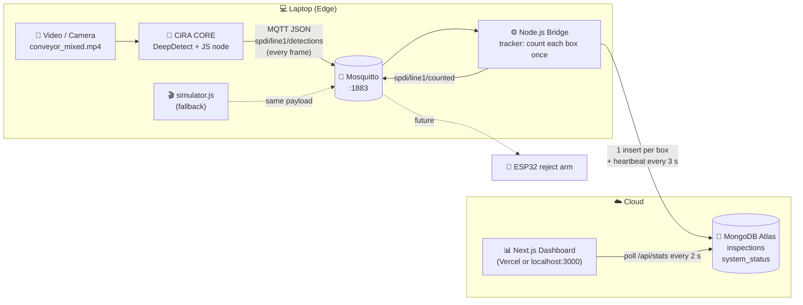

# SPDI Architecture



## ข้อมูลไหลอย่างไร
1. **CiRA CORE** อ่านวิดีโอ → DeepDetect หา bounding box + class (`good` / `damaged`) ทุกเฟรม
2. JavaScript node แปลงผลเป็น JSON สั้น ๆ แล้ว node **MqttPub** ส่งไป `spdi/line1/detections` (~10–15 ข้อความ/วินาที)
3. **Bridge** รับทุกเฟรม → ติดตามกล่อง (centroid tracking) → เมื่อกล่องข้าม **เส้นนับเสมือน** จะนับ **1 ครั้ง** และตัดสินผลด้วยการโหวตจากทุกเฟรม
4. Bridge บันทึก **1 document ต่อ 1 กล่อง** ลง `inspections` และส่งต่อไป `spdi/line1/counted`
5. **Dashboard** ดึงสรุปจาก MongoDB ทุก 2 วินาที

## ทำไมใช้ MQTT
- เป็นมาตรฐาน IoT: publish/subscribe เบา, header แค่ 2 byte, เหมาะกับข้อมูลถี่ ๆ
- **แยกผู้ส่งกับผู้รับออกจากกัน (decoupling)**: CiRA ไม่ต้องรู้ว่าใครรับ — วันหน้าเพิ่ม ESP32 แขนคัดกล่อง (subscribe `counted`) ได้เลยโดยไม่แก้ CiRA
- CiRA CORE มี MQTT node ในตัว ไม่ต้องเขียนโปรแกรมเพิ่ม

## ทำไมต้องมี Bridge (ไม่ส่งจาก CiRA ลง DB ตรง ๆ)
- **Frame → Event**: กล่อง 1 ใบอยู่ในจอ ~40 เฟรม ถ้าบันทึกทุกเฟรม = นับซ้ำ 40 ครั้ง และ Atlas free tier รับได้ ~100 ops/s
- **De-duplication**: tracker ให้ ID กล่อง, นับเมื่อข้ามเส้นเท่านั้น, กล่องที่เกิดหลังเส้นจะไม่ถูกนับ → ไม่นับซ้ำแม้โมเดลกระพริบ
- **Majority vote**: โมเดลอาจทายผิดบางเฟรม (noise) → ใช้ผลรวมทุกเฟรม และ **เอนไปทาง FAIL** (`FAIL_RATIO=0.3`) เพราะปล่อยกล่องเสียหลุดไปแพงกว่าตรวจซ้ำกล่องดี
- **ทนข้อมูลหลายรูปแบบ**: รับ payload ได้หลาย shape (CiRA ต่างเวอร์ชันส่งไม่เหมือนกัน), pixel หรือ normalized, confidence 0–1 หรือ 0–100
- **ทนเน็ตหลุด**: MQTT auto-reconnect, event ที่เขียน DB ไม่สำเร็จจะเก็บในคิวแล้วเขียนซ้ำ, `eventId` unique index กันข้อมูลซ้ำ

## ทำไมใช้ MongoDB (Atlas)
- เก็บ JSON ได้ตรง ๆ (event จาก MQTT เป็น JSON อยู่แล้ว) ไม่ต้องออกแบบตารางล่วงหน้า
- Aggregation pipeline (`$group`, `$dateTrunc`, `$facet`) สรุปต่อนาที/ชั่วโมงได้ใน query เดียว
- Atlas ฟรี (M0), อยู่บน cloud → dashboard บน Vercel อ่านได้จากทุกที่

### Schema
`inspections` — 1 document = กล่อง 1 ใบ (`result` มีแค่ `PASS` / `FAIL` → **total = good + damaged เสมอ**)
```json
{
  "eventId": "line1-mbx12ab3f-12", "ts": "2026-11-05T03:12:45Z", "line": "line1", "device": "cira-01",
  "result": "FAIL", "className": "damaged_box", "confidence": 0.91, "trackId": 12,
  "framesSeen": 38, "votes": { "pass": 3, "fail": 35 }, "source": "cira", "createdAt": "..."
}
```
Indexes: `eventId` (unique), `ts` (desc)

`system_status` — heartbeat `_id: "bridge"` อัปเดตทุก 3 วินาที: `mqttConnected, fps, activeTracks, lastFrameAt, lastEventAt, updatedAt`
Dashboard ใช้ค่าเหล่านี้ทำไฟสถานะ (CiRA เขียวถ้า `lastFrameAt` < 5 s, Bridge/MQTT เขียวถ้า `updatedAt` < 10 s)

## Edge AI คืออะไร (ในโปรเจกต์นี้)
- **AI ประมวลผลที่ปลายทาง (laptop ข้างสายพาน)** ไม่ได้ส่งวิดีโอขึ้น cloud
- ส่งขึ้น cloud แค่ **ผลลัพธ์** (กล่องละ ~300 byte) แทนวิดีโอ (หลาย MB/วินาที) → ประหยัดแบนด์วิดท์, latency ต่ำ, ภาพไม่รั่วออกนอกโรงงาน (privacy)
- ถ้าเน็ตหลุด การตรวจยังทำงานต่อได้ และ bridge จะเขียนข้อมูลที่ค้างเมื่อเน็ตกลับมา

## การ deploy
| ส่วน | อยู่ที่ |
|---|---|
| CiRA CORE, Mosquitto, Bridge | laptop (edge) |
| MongoDB | Atlas (cloud) |
| Dashboard | `localhost:3000` หรือ Vercel (Root Directory = `dashboard`) |
