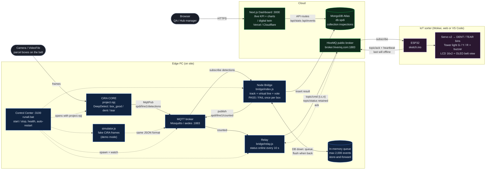
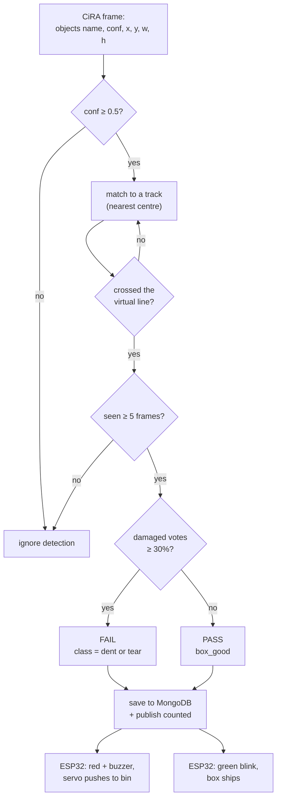

# SPDI System Architecture

AI Parcel Box Damage Detection System: Edge AI (CiRA CORE) → MQTT → Node Bridge → MongoDB Atlas → Next.js Dashboard, with an ESP32 sorter driven over MQTT.

High-resolution images: [system-architecture.png](architecture/system-architecture.png) · [decision-flow.png](architecture/decision-flow.png)

## Decision flow per box

## Components

| Part | Tech | Port / Topic | Role |
|---|---|---|---|
| CiRA CORE | DeepDetect | publishes `spdi/line1/detections` | Edge AI, 3 classes |
| MQTT broker | Mosquitto / aedes | `:1883` | local messaging, no internet needed |
| Bridge | Node.js | subscribes detections, publishes `spdi/line1/counted` | tracking, counting, PASS / FAIL, store-and-forward |
| MongoDB Atlas | MongoDB | collection `inspections` | stores every inspected box |
| Dashboard | Next.js | `:3000`, Vercel / Cloudflare | KPI, charts, hourly summary, digital twin |
| Relay | Node.js | `RELAY_TOPIC/cmd`, `/status`, `/ack` | forwards results to the ESP32 |
| ESP32 | Arduino on Wokwi | HiveMQ `:1883` | servos, tower light, buzzer, LCD, OLED |
| Control Center | Node.js + SSE | `:3100` | one-click start, health of all 7 stages |
